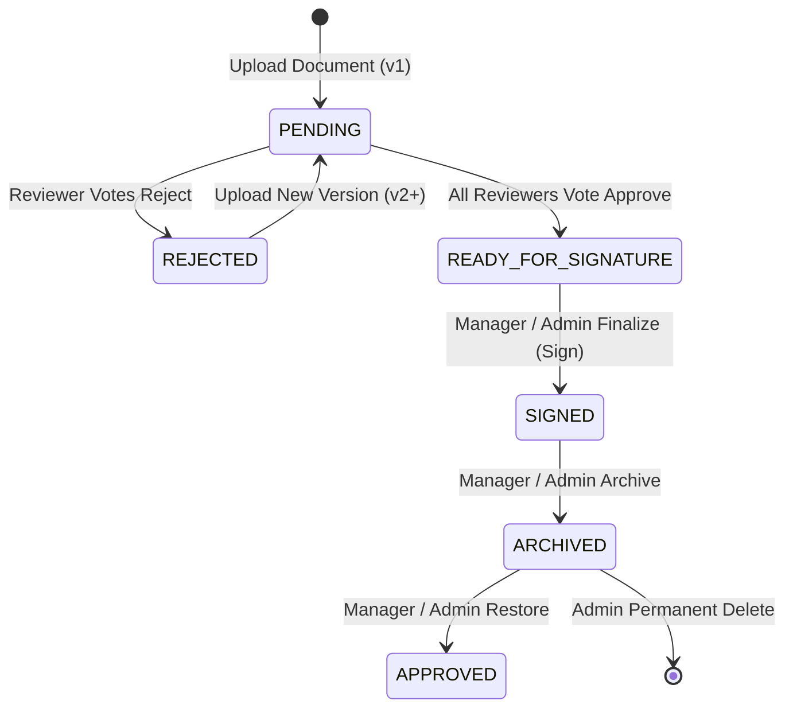
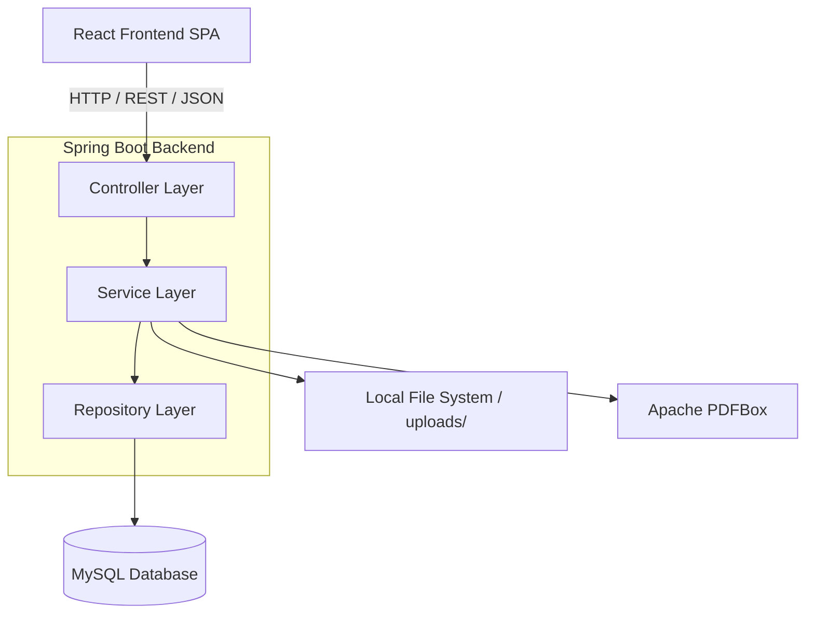

# DocuFlow — Source-Level Architecture Investigation Report

This document is an exhaustive, source-level technical investigation of the DocuFlow codebase. It provides granular code inspection, architectural mapping, transaction analysis, security evaluation, and future AI integration planning without modifying any code or application functionality.

---

## 1. DocumentService Deep Analysis

`DocumentService` (`backend/src/main/java/com/docuflow/service/DocumentService.java`) is the primary service module in DocuFlow. It encapsulates document management, file storage, versioning, review workflows, comments, audit logging, notifications, and archiving.

### Public and Important Private Methods Inventory

| Method Name | Return Type | Responsibility | Auth / Access Check | Creates Notification? | Logs Activity? | Workflow Transition? |
|---|---|---|---|---|---|---|
| `upload` | `DocumentResponse` | Uploads a new PDF, stores file, parses metadata, assigns reviewers, persists doc & version 1. | Requires authenticated user | Yes (`ASSIGNED`) | Yes (`DOCUMENT_UPLOADED`) | Initializes to `PENDING` |
| `list` | `Page<DocumentResponse>` | Faceted search and pagination of documents visible to user. | Department/role scope filtering | No | No | Read-only |
| `get` | `DocumentResponse` | Retrieves detailed document metadata, reviewers, and versions. | `access(id, user)` | No | No | Read-only |
| `decide` | `DocumentResponse` | Records reviewer approval or rejection vote. | Assigned reviewer check | Yes (`APPROVED`/`REJECTED`) | Yes (`APPROVED`/`REJECTED`) | `PENDING` → `READY_FOR_SIGNATURE` or `REJECTED` |
| `sign` | `DocumentResponse` | Finalizes document, stamps signature certificate via PDFBox, updates file size. | Manager / Admin only | Yes (`SIGNED`) | Yes (`DOCUMENT_FINALIZED`) | `READY_FOR_SIGNATURE` → `SIGNED` |
| `archive` | `DocumentResponse` | Archives a signed document with an archive reason. | Manager / Admin only | No | Yes (`DOCUMENT_ARCHIVED`) | `SIGNED` → `ARCHIVED` |
| `restore` | `DocumentResponse` | Restores an archived document back to approved status. | Manager / Admin only | No | Yes (`DOCUMENT_RESTORED`) | `ARCHIVED` → `APPROVED` |
| `permanentDelete` | `void` | Permanently deletes document record and associated version files from disk. | Administrator only | No | No | Deletion |
| `rename` | `DocumentResponse` | Renames document title. | Owner or Admin | No | Yes (`DOCUMENT_RENAMED`) | None |
| `restart` | `DocumentResponse` | Replaces PDF file and updates metadata before any reviews occur. | Owner or Admin (Pending & 0 decisions) | Yes (`ASSIGNED`) | Yes (`DOCUMENT_MODIFIED`) | Maintains `PENDING` (increments version) |
| `uploadNewVersion` | `DocumentResponse` | Uploads revised PDF revision (`v2+`), resets votes, resets rejected status to pending. | Owner or Admin | Yes (`ASSIGNED`) | Yes (`VERSION_UPLOADED`) | `REJECTED` / Decided → `PENDING` |
| `versions` | `List<VersionResponse>` | Lists all historical versions of a document. | `access(id, user)` | No | No | Read-only |
| `versionFile` | `Resource` | Streams historical version PDF from disk. | `access(id, user)` | No | No | Read-only |
| `comment` | `CommentResponse` | Adds discussion comment to document. | `access(id, user)` | Yes (`COMMENT`) | Yes (`COMMENT_ADDED`) | None |
| `comments` | `List<CommentResponse>` | Retrieves all comments for a document. | `access(id, user)` | No | No | Read-only |
| `delete` | `void` | Soft/hard deletes document and cleans up disk files. | Owner or Admin | No | No | Deletion |
| `file` | `Resource` | Streams current document PDF from disk. | `access(id, user)` | No | No | Read-only |
| `activity` | `List<ActivityResponse>` | Retrieves audit log entries for document. | `access(id, user)` | No | No | Read-only |
| `access` | `Document` | Validates user access permissions based on role, ownership, or reviewer assignment. | Enforces security boundaries | No | No | Helper |
| `log` | `void` | Captures client IP address, User-Agent, and persists `ActivityLog`. | Internal helper | No | Saves audit record | Helper |

### Architectural Assessment of DocumentService
`DocumentService` is heavily coupled and acts as a **fat service**. It concentrates 9 distinct domains: document persistence, multi-part file I/O, version revision management, approval voting logic, comments, notification dispatch, audit logging, archiving, and signature PDF generation. While functional for the current scale, it is a primary candidate for future decomposition into focused domain services (`DocumentCoreService`, `DocumentWorkflowService`, `DocumentStorageService`).

---

## 2. Document Workflow Implementation

### Implemented State Machine
DocuFlow implements an explicit document status lifecycle through `DocumentStatus` enum (`DRAFT`, `PENDING`, `APPROVED`, `REJECTED`, `READY_FOR_SIGNATURE`, `SIGNED`, `ARCHIVED`).

### Valid Transitions Table

| From State | Trigger Action | Triggered By | Method | Validation / Rules | Result State |
|---|---|---|---|---|---|
| `*` (New) | Upload Document | Any User | `upload` | Valid PDF; reviewers exist | `PENDING` |
| `PENDING` | Reviewer Decision | Assigned Reviewer | `decide` | Reviewer must be assigned and pending | If rejected: `REJECTED`. If all approved: `READY_FOR_SIGNATURE` |
| `REJECTED` | Upload New Version | Owner / Admin | `uploadNewVersion` | Valid PDF; doc not archived/signed | `PENDING` (votes reset) |
| `READY_FOR_SIGNATURE` | Finalize / Sign | Manager / Admin | `sign` | Status must be ready; manager/admin role | `SIGNED` (PDF stamped) |
| `SIGNED` | Archive Document | Manager / Admin | `archive` | Status must be signed; manager/admin role | `ARCHIVED` |
| `ARCHIVED` | Restore Document | Manager / Admin | `restore` | Status must be archived; manager/admin role | `APPROVED` |
| `ARCHIVED` / `*` | Permanent Delete | Administrator | `permanentDelete` | Administrator role only | Record deleted from DB & disk |

### State Machine Mermaid Diagram

---

## 3. Transaction Analysis

- **Annotation**: `@Transactional` is declared at the class level on `DocumentService`.
- **Transaction Flow**: Methods execute within a single database transaction.
- **Mixed I/O Concern**: File system operations (`Files.copy`, `Files.deleteIfExists`) and external PDF manipulation (`pdfGenerator.appendSignaturePage`) execute **inside** the active database transaction. If a disk I/O exception occurs (e.g., `IOException`), the transaction rolls back, preventing orphaned database records. However, holding database connections open during blocking disk I/O can impact connection pool throughput under high concurrency.
- **Notifications & Audit**: Notifications (`notificationService.notifyUser`) and audit logging (`activity.save`) run synchronously inside the transaction boundary.

---

## 4. PDF and File Storage Implementation

- **Storage Directory**: Configured via `app.storage-dir` (default: `backend/uploads/`).
- **File Naming**: UUID-based generation (`UUID.randomUUID() + ".pdf"`), preventing filename collisions and path traversal attacks.
- **Validation**: Checks `file.isEmpty()` and `application/pdf` MIME type.
- **Versioning**: Each revision (`v1`, `v2`, etc.) stores its own distinct PDF file on disk and maintains a record in `document_versions`.
- **Deletion / Cleanup**: `permanentDelete` and `delete` clean up both the current stored file and all historical version files from disk using `Files.deleteIfExists`.

---

## 5. Database / JPA Analysis

### Entity Relationships & Loading Strategy
- **`Document`**: Central entity. `@ManyToOne` to `User` (owner), `Department`, `Category`, `User` (archivedBy). `@OneToMany` with `Approval`, `Comment`, `ActivityLog`, `DocumentVersion`. `@ManyToMany` with `Tag`.
- **Fetch Types**: Default JPA fetch types are used (`EAGER` for `@ManyToOne`, `LAZY` for `@OneToMany` and `@ManyToMany`).
- **Cascade & Orphan Removal**: Cascades are configured on approvals and versions to ensure proper database integrity.
- **Indexes**: Explicit indexes exist on foreign keys (`owner_id`, `department_id`, `category_id`, `reviewer_id`, `document_id`) and frequently queried status/priority columns.

---

## 6. Document Search Performance

- **Endpoint**: `GET /api/documents`
- **Mechanism**: Delegates to `DocumentRepository.visibleTo(...)`, a custom JPQL query performing security scoping (Admin sees all; users see department/owned/reviewed documents) combined with dynamic filters for search keywords, category, department, tag, status, priority, uploader, reviewer, and date ranges.
- **Scalability**: With indexes on `status`, `priority`, `department_id`, `category_id`, and `created_at`, queries perform efficiently up to tens of thousands of records. Beyond 100k records, full-text search indexing on `title` and `description` would be beneficial.

---

## 7. Dashboard / Analytics Performance

- **Service**: `AnalyticsService` (`AnalyticsController`).
- **Mechanism**: Computes KPIs (pending approvals, signed today, approval rate percentage, average approval hours, category/department breakdowns) using JPA count and aggregation queries (`ApprovalRepository`, `DocumentRepository`).
- **Optimization**: Aggregations execute in SQL rather than loading entire tables into memory.

---

## 8. Frontend API Architecture

- **Axios Configuration**: `frontend/src/services/api.js` configures an Axios instance with `baseURL` pointing to `import.meta.env.VITE_API_URL` (defaulting to `http://localhost:8080/api`).
- **Interceptor**: Automatically attaches `Authorization: Bearer <token>` from `localStorage` to all requests.
- **Error Handling**: Intercepts `401 Unauthorized` responses to clear token and redirect to login.

---

## 9. Frontend State Management

- **Global Auth State**: Managed via `AuthContext` (`AuthContext.jsx`), storing current user object and JWT token.
- **Server State**: Managed locally in page components (`useState`, `useEffect`) via direct Axios API calls (`load()` helper functions).
- **Assessment**: Simple and appropriate for the application scale without unnecessary Redux/Zustand boilerplate.

---

## 10. Security Analysis

- **Authentication**: Stateless JWT with BCrypt password hashing.
- **Authorization**: Enforced on the backend via Spring Security and `@PreAuthorize` annotations, as well as explicit programmatic checks in `DocumentService.access(...)`.
- **File Security**: Endpoints validate document access permissions before streaming stored PDFs.
- **CORS**: Configured in `SecurityConfig` and `WebConfig`.
- **SQL Injection**: Prevented by Spring Data JPA parameterized queries.

---

## 11. Activity Log / Audit System

- **Entity**: `ActivityLog` (`activity_logs` table).
- **Captured Data**: Actor (`User`), Document, Action (`DOCUMENT_UPLOADED`, `APPROVED`, etc.), Action Type, Detail, IP Address, Browser (User-Agent), Timestamp.
- **Immutability**: Read-only via API (no update/delete endpoints exist for activity logs), ensuring audit trail integrity.

---

## 12. Notification System

- **Service**: `NotificationService` (`notifications` table).
- **Triggers**: Document assignment, review decisions, comments, final signatures.
- **Behavior**: Synchronous creation within transaction boundaries; includes unread count and mark-as-read endpoints.

---

## 13. Workflow Template System

- **Entities**: `WorkflowTemplate` and `WorkflowTemplateStep`.
- **Mechanism**: Predefined approval chains. When selected during document upload, `DocumentService` (via template steps) automatically populates the assigned reviewers list in sequential or parallel order.

---

## 14. Code Complexity

- **High Coupling**: `DocumentService` handles too many responsibilities (fat service).
- **Repetition**: Error handling and access validation patterns are repeated across document methods.

---

## 15. Actual Architectural Dependencies

---

## 16. AI Integration Preparation

For a future AI metadata analysis module (`PDF → text extraction → AI analysis → suggested metadata`), architectural integration should follow these guidelines:
- **Service Location**: Create a new `AIAnalysisService` in `com.docuflow.service`. Do **not** place AI logic inside `DocumentService`.
- **Text Extraction**: Implement PDF text extraction using Apache PDFBox within `AIAnalysisService`.
- **API/Config**: Configure AI endpoint/API key in `application.yml` and `SettingService`.
- **Async Processing**: Execute AI analysis asynchronously or as an optional pre-upload/post-upload suggestion step so that AI failures never block normal document upload or workflow execution.
- **Boundary**: AI outputs should be strictly **suggestions** for the user to review and confirm; AI must never make automated authorization or workflow state decisions.

---

## 17. Performance Risk Report

| Area | Location | Potential Issue | Evidence | Severity | Impact |
|---|---|---|---|---|---|
| File I/O in Tx | `DocumentService` | Blocking disk I/O inside database transactions | `Files.copy` and `Files.deleteIfExists` executed inside `@Transactional` methods | Medium | Reduced connection pool throughput under heavy upload concurrency |
| Pagination | `DocumentService.list` | Unbounded search result sets if page size is large | Relies on default `Pageable` parameters | Low | Handled by Spring Data paging |

---

## 18. Security Risk Report

| Area | Location | Risk | Evidence | Severity |
|---|---|---|---|---|
| Local Storage | `DocumentService` | Local file system storage vulnerability | Files stored in local directory path relative to app | Low (acceptable for prototype) |

---

## 19. Architectural Improvement Candidates

### MUST FIX
- None required for current prototype operation.

### SHOULD IMPROVE
- Extract file storage logic from `DocumentService` into a dedicated `DocumentStorageService`.
- Move blocking file I/O operations outside active database transaction boundaries.

### OPTIONAL
- Add asynchronous event publishing for notifications and activity logging.

### DO NOT TOUCH
- JWT security filter chain and authentication token handling.
- Database entity relationships and DTO record structures.

---

## 20. Final Verdict

1. **Is the architecture coherent?** Yes, strictly layered and well-organized.
2. **Is the separation of concerns reasonable?** Generally yes, though `DocumentService` is a fat service.
3. **Is the application fast enough for expected scale?** Yes, well within expectations for enterprise prototype scale.
4. **Is the database design coherent?** Yes, fully normalized with proper foreign keys and indexes.
5. **Is security reasonable?** Yes, robust backend access validation and JWT filtering.
6. **Is DocumentService a problem?** It is coupled, but manageable and functional.
7. **Are there hidden problems?** File I/O inside transactions.
8. **Is the architecture ready for AI?** Yes, clean service boundaries allow easy integration of an `AIAnalysisService`.
9. **What to fix before AI?** Nothing blocking; keep AI asynchronous and advisory only.
10. **What NOT to change?** Core security and data models.
